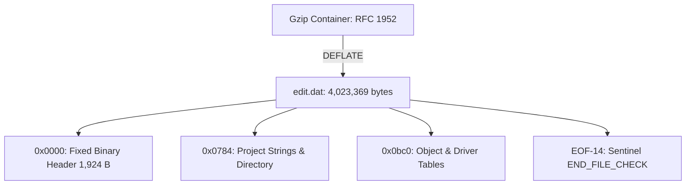

# 33. Master Project Database (`CCS/edit.dat.gz`)

## 1. Overview & Operational Lifecycle

In the URC Total Control ecosystem, `CCS/edit.dat.gz` represents the canonical master project database authored by the Windows PC dealer software (Total Control Accelerator 3 or TC Flex).

### 1.1 Architecture & Role

1. **Storage Location:** `/remote/Store/CCS/edit.dat.gz` (uncompressed inside upload packages as `_edit.dat.gz`).
2. **Controller Runtime Decoupling:** The MRX controller daemons (`BS.exe`, `devmngd.exe`, `rui_svrd.exe`) **do not** parse, load, or execute `edit.dat` during normal operation. Controller execution is driven entirely by downstream compiled representations:
   - `DnData.dn`: binary action/macro tables and device configurations (consumed by `BS.exe`).
   - `mcs.dat` and `mcs_info.dat`: JSON topology models (consumed by `BS.exe` and `rmsmcsman.exe`).
   - `TwoWay/*.tcl`: encrypted drivers (consumed by `tclpkg`).
   - `FB/*.fb`: audio feedback descriptors.
3. **Upload / Backup Role:** `edit.dat.gz` exists on the controller to enable the dealer **"Upload from Controller"** feature. When a programmer connects to an existing controller without having the project file on their PC, the controller transmits `/remote/Store/CCS/edit.dat.gz` back to the PC software, which decompresses and opens it as a `.tc3` project.
4. **Cloud / RMS Telemetry:** `rmsmcsman.exe` scans `edit.dat` for the string `CCP_BIN_VER_STR` to report the authoring editor version (`3.02.0628.4`) to URC Cloud / RMS services.

---

## 2. Container Framing, Compression & Decompression

`CCS/edit.dat.gz` is compressed using standard gzip format (`RFC 1952`) with the DEFLATE algorithm:

| Offset | Size | Type | Value / Meaning |
|---|---|---|---|
| `0x00` | 2 | `bytes` | `0x1f 0x8b` (Gzip ID1 and ID2) |
| `0x02` | 1 | `uint8` | `0x08` (Compression Method: DEFLATE) |
| `0x03` | 1 | `uint8` | `0x08` (Flags: `FNAME` present) |
| `0x04` | 4 | `uint32_le` | MTIME (Authoring Unix timestamp) |
| `0x08` | 1 | `uint8` | `0x00` (XFL: Extra flags) |
| `0x09` | 1 | `uint8` | `0x00` (OS: FAT/Windows) |
| `0x0a` | variable | `string` | Zero-terminated member name: `edit.dat\0` |
| ... | variable | `bytes` | Compressed DEFLATE stream |
| EOF-8 | 4 | `uint32_le` | CRC-32 of uncompressed payload |
| EOF-4 | 4 | `uint32_le` | ISIZE (Uncompressed size modulo $2^{32}$) |

### 2.1 Recompression Procedure
To create a compliant `edit.dat.gz` package from an uncompressed `edit.dat` stream:
1. Initialize an `RFC 1952` gzip container with filename `edit.dat`.
2. Compress the uncompressed database bytes using DEFLATE (level 6 or 9).
3. Compute the CRC-32 and payload length of the uncompressed data and write them in the 8-byte gzip footer.
4. Save the archive as `_edit.dat.gz` in the upload staging root (`/remote/Store/updateroot/`).

## 3. Database Framing & Structural Layout

The decompressed database `edit.dat` consists of four distinct sections:
1. **Header Block (`0x0000 – 0x0784`)**: Fixed-offset project metadata, dealer contact info, GPS location, and timezone definition.
2. **Project String Table & Directory (`0x0784 – 0x0bc0`)**: Project filenames, delimiter sync arrays, and table directory offsets.
3. **Object Data Tables (`0x0bc0 – EOF-14`)**: Sequential object definitions for Rooms, Devices, Matrix Routers, Macros, and Drivers.
4. **Sentinel Footer (`EOF-14 – EOF`)**: 14-byte ASCII terminator `END_FILE_CHECK`.



---

## 4. Header Field Specification

All fields are Little-Endian. Fixed-width strings are null-padded.

| Offset | Size | Type | Value / Example | Meaning |
|---|---|---|---|---|
| `0x0000` | 4 | `uint32_le` | `1917` (`0x0000077d`) | File Format Magic Identifier |
| `0x0004` | 4 | `uint32_le` | `2109440` (`0x00203000`) | Database Schema Version (`3.0.0`) |
| `0x0008` | 32 | `string` | `T15\0...` | Primary Target Controller Model Code |
| `0x0028` | 32 | `bytes` | `0x00...` | Reserved / padding |
| `0x0048` | 15 | `string` | `CCP_BIN_VER_STR` | Version signature prefix |
| `0x0057` | 17 | `string` | `3.02.0628.4     ` | Accelerator / Editor build version |
| `0x0068` | 32 | `bytes` | `0x00...` | Reserved / padding |
| `0x0088` | 32 | `string` | `Accelerator 3 -\0...` | Authoring software suite title |
| `0x00a8` | 32 | `bytes` | `0x00...` | Reserved / padding |
| `0x00c8` | 1 | `uint8` | `1` | Dealer info enabled flag (`1`=enabled) |
| `0x00c9` | 128 | `string` | `Sample Integrations LLC` | Installing Dealer / Company Name |
| `0x0149` | 64 | `string` | `555-555-0100` | Dealer Contact Phone Number |
| `0x0189` | 128 | `string` | `installer@example.com` | Dealer Contact Email |
| `0x0209` | 481 | `bytes` | `0x00...` | Dealer notes & street address padding |
| `0x03ea` | 32 | `string` | `00000` | Postal / Zip Code |
| `0x040a` | 8 | `float64_le` | `0.0` | Site Latitude (IEEE 754 double) |
| `0x0412` | 8 | `float64_le` | `0.0` | Site Longitude (IEEE 754 double) |
| `0x041a` | 4 | `int32_le` | `0` | Timezone Bias in minutes (`0` = UTC) |
| `0x041e` | 64 | `utf16_le` | `Standard Time` | Win32 Standard Timezone Name |
| `0x045e` | 16 | `bytes` | `SYSTEMTIME` (8x uint16) | Standard Time transition date |
| `0x046e` | 4 | `int32_le` | `0` | Standard Bias in minutes |
| `0x0472` | 64 | `utf16_le` | `Daylight Time` | Win32 Daylight Timezone Name |
| `0x04b2` | 16 | `bytes` | `SYSTEMTIME` (8x uint16) | Daylight Time transition date |
| `0x04c2` | 4 | `int32_le` | `-60` | Daylight Bias in minutes (`-60` = 1 hr advance) |
| `0x04c6` | 4 | `bytes` | `0xff 0x01 0x00 0x00` | Header section transition marker |
| `0x04ca` | 64 | `bytes` | 16x `0x4f965bc2` | Header sync delimiter block |
| `0x059c` | 64 | `string` | `City, State, Country` | Geographic Location Label |
| `0x063d` | 32 | `string` | `00000` | Secondary Postal Code |
| `0x065d` | 16 | `string` | `0.0` | Formatted Latitude String |
| `0x066d` | 16 | `string` | `0.0` | Formatted Longitude String |
| `0x0681` | 64 | `string` | `Project.tc3` | Windows Project Source File Name |
| `0x0784` | 32 | `string` | `Sample Project` | Short Project Name |

---

## 5. Directory & Object Table Indexing

Following the project names, at offset `0x0ba4` is the primary table offset directory:

| Offset | Size | Type | Value | Meaning |
|---|---|---|---|---|
| `0x0ba4` | 4 | `uint32_le` | `0` | Directory Table Flag |
| `0x0ba8` | 4 | `uint32_le` | `3` | Room Count ($N=3$) |
| `0x0bac` | 4 | `uint32_le` | `0x00000bc0` | Room 0 Offset (3,008 B: "Server Room") |
| `0x0bb0` | 4 | `uint32_le` | `0x00032a7b` | Room 1 Offset (207,483 B: "Living Room") |
| `0x0bb4` | 4 | `uint32_le` | `0x00034acc` | Room 2 Offset (215,756 B: "Exercise Room") |
| `0x0bb8` | 4 | `uint32_le` | `0x00036234` | Audio Matrix Router Offset (221,748 B: "MRX-15 Master") |
| `0x0bbc` | 4 | `uint32_le` | `0x003d026f` | CCS Driver Section Offset (3,998,319 B) |

---

## 6. Inner Object & Record Specifications

### 6.1 Room Object Model
Each room entry indexed in the directory begins with an indexed header and an inner device offset array:

| Field | Size | Type | Description |
|---|---|---|---|
| `room_id` | 4 | `uint32_le` | Zero-based logical room index |
| `name_len` | 2 | `uint16_le` | Byte length of room name including null terminator |
| `room_name` | variable | `string` | Zero-terminated room name string (e.g. `Server Room\0`) |
| `code_prefix` | 1 | `uint8` | Constant `0x00` |
| `code_len` | 2 | `uint16_le` | Length of room type code |
| `room_code` | variable | `string` | Zero-terminated room type code (e.g. `RV\0`) |
| `flags` | 48 | `bytes` | Room state, default volume, and zone routing bitmask |
| `device_count` | 4 | `uint32_le` | Count ($M$) of member device record offsets |
| `device_offsets` | $4 \times M$ | `uint32_le[]` | Array of absolute file offsets to member device records |

### 6.2 Inner Device Record Model
Member devices within each room define hardware IDs, global object IDs, and communication bindings:

| Field | Size | Type | Description |
|---|---|---|---|
| `device_idx` | 4 | `uint32_le` | Zero-based room device sequence index |
| `model_len` | 2 | `uint16_le` | Byte length of device model string |
| `model` | variable | `string` | Zero-terminated model identifier (e.g. `MRX-15\0`, `DBMODEL\0`) |
| `hw_id` | 4 | `uint32_le` | Hardware model identifier (e.g. `0x8000` = MRX-15) |
| `obj_id` | 4 | `uint32_le` | Global system object ID matching `mcs_info.dat` |
| `name_len` | 2 | `uint16_le` | Byte length of device display label |
| `device_name` | variable | `string` | Zero-terminated display name (e.g. `APPLE TV Great Room\0`) |
| `type_len` | 2 | `uint16_le` | Byte length of device category string |
| `device_type` | variable | `string` | Zero-terminated category (e.g. `APPLE TV\0`) |
| `transport_len`| 2 | `uint16_le` | Byte length of transport descriptor |
| `transport` | variable | `string` | Control protocol (`IR\0`, `IP\0`, `RS232\0`) |
| `brand_len` | 2 | `uint16_le` | Length of manufacturer brand string |
| `brand` | variable | `string` | Manufacturer name (e.g. `Apple\0`) |
| `delimiters` | variable | `bytes` | Synchronization delimiter sequences (`0x4f965bc2`) |

### 6.3 Macro & Command Actions
Buttons and UI functions embed action sequences:
- **JSON Commands:** For IP/streaming devices (such as Sonos or HDA matrix zones), commands carry UTF-8 JSON payloads:
  - Format: 4-byte `uint32_le` command ID, 4-byte `uint32_le` function ID (matching `mcs.dat` function IDs, e.g. `275` for `Vol+`), 2-byte length-prefixed button label, followed by 4-byte `uint32_le` length-prefixed JSON payload:
    `{"type":"set","zone":{"id":"z1lr","ctrl":{"volume":"+"}}}`
- **Pulse Timing IR Codes:** For IR devices, commands carry 4-byte `uint32_le` length prefixes, 4-byte function ID (e.g. `4096` for `PLAY`), 2-byte button label, and raw 44-byte encoded carrier pulse timing buffers.

### 6.4 CCS Driver Section Framing
Located at offset `0x003d026f` (driver table offset), the database packages reusable driver records:
- Offset `0x00`: 4-byte `uint32_le` driver count ($D=6$).
- Per driver:
  - 4-byte `uint32_le` payload byte length.
  - 32-byte header with ASCII identifier `CCS DRIVER\0`.
  - 4-byte category code (e.g. `0x00007001`).
  - Brand and Model length-prefixed strings.
  - Protocol identifier string (`IR\0`, `IP\0`).
  - Array of discrete function command records (names, IDs, pulse timing / IP payload blocks).

## 7. File Termination Sentinel

The file terminates at the very last 14 bytes with:
```
45 4e 44 5f 46 49 4c 45 5f 43 48 45 43 4b
E  N  D  _  F  I  L  E  _  C  H  E  C  K
```
Any compliant generator or validator **MUST** ensure the uncompressed payload ends with `END_FILE_CHECK`.

---

## 8. Verification & Synthetic Test Vectors

### 8.1 Synthetic Minimal Test Vector
To enable clean-room implementers to generate and validate minimal valid databases without referencing vendor files:

An authored test database is constructed as follows:
- **Magic:** `1917` (`0x0000077d`)
- **Schema Version:** `2109440` (`0x00203000`)
- **Target Model:** `MRX-15` (padded to 32 bytes)
- **Version Tag:** `CCP_BIN_VER_STR`
- **Build Version:** `3.02.0628.4     `
- **App Title:** `Open Programmer`
- **Dealer Info:** Enabled (`1`), Company: `Clean Room Audio`, Phone: `555-0199`, Email: `test@example.com`
- **Coordinates:** Latitude `40.7128`, Longitude `-74.0060` (New York)
- **Timezone:** Bias `300` (UTC-5), Standard Name `Eastern Standard Time`
- **Directory Block:** Located at `0x0ba4` with 0 rooms and matrix offset pointing directly to footer.
- **Sentinel:** Terminated with `END_FILE_CHECK` (`0x45 0x4e 0x44 0x5f 0x46 0x49 0x4c 0x45 0x5f 0x43 0x48 0x45 0x43 0x4b`).

### 8.2 Clean-Room Generation Invariant
An open-source programmer generating an MRX project package **MUST** provide `CCS/edit.dat.gz` in the upload staging set to ensure dealer PC software can perform "Upload from Controller" without error.

---

## 9. Open Items

None. Master project database framing and inner record models are fully specified.
